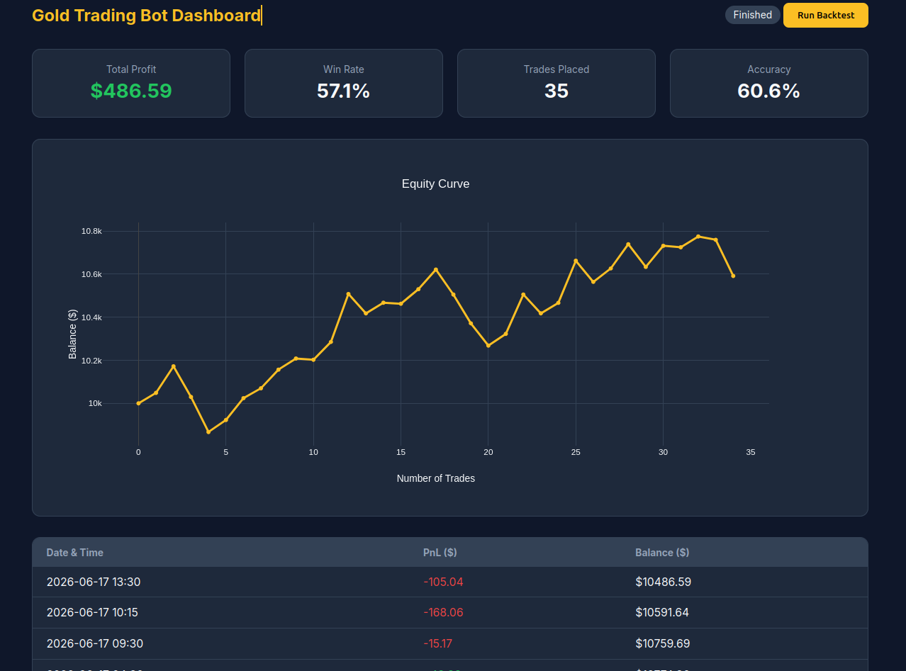

# 🥇 AI Trader XAU/USD

<div align="center">

[](https://www.python.org/)
[](https://flask.palletsprojects.com/)
[](https://scikit-learn.org/)
[](LICENSE)

</div>

An educational algorithmic-trading project for Gold (XAU/USD). It combines an
ML signal model with a strict risk engine and a backtester that simulates
spreads and commissions, exposed through a small Flask dashboard.



---

## Features

- **ML signals** — trained model predicts direction over a 4-hour horizon.
- **Session filter** — focuses on London and New York liquidity windows.
- **ATR stops** — volatility-adjusted initial stop-loss.
- **Partial scaling** — 50% off at TP1, stop moved to break-even, remainder at TP2.
- **Realistic costs** — spread and commission simulated by market hours.
- **Circuit breaker** — pauses trading after a losing streak.
- **Web dashboard** — start a backtest and watch equity, trades and win rate.

---

## Stack

| Layer | Choice |
|---|---|
| Language | Python 3.10+ |
| Data | pandas, numpy, yfinance |
| Indicators | pandas_ta + custom ATR helper |
| Model | scikit-learn / XGBoost-compatible `MLModel` wrapper |
| Web | Flask + Flask-CORS, Plotly charts |
| Design | Object-oriented, MVC-inspired modules |

---

## Layout

```text
Ai_Trader_XAUUSD/
├── app.py            # Flask app, /api/start_backtest and /api/results
├── bot.py            # GoldBot execution engine
├── signals.py        # signal generation interface
├── ml_model.py       # data fetch + model training
├── indicators.py     # ATR and technical helpers
├── risk.py           # position sizing, stops, circuit breaker
├── templates/
│   └── index.html    # dashboard rendered by Flask
├── Dashboard.png
└── requirements.txt
```

---

## Run

```bash
python -m venv .venv
source .venv/bin/activate        # Windows: .venv\Scripts\activate
pip install -r requirements.txt
python app.py
```

Open <http://localhost:5000> and press **Run Backtest**. The dashboard polls
`/api/results` while the simulation runs on a background thread.

### What a backtest does

1. Fetches 60 days of 15-minute XAU/USD data with `yfinance`.
2. Splits 70/30 into training and out-of-sample data.
3. Trains `MLModel(horizon=16)`.
4. Walks the test set with a 200-bar window, feeding `GoldBot.run_iteration()`.
5. Publishes PnL, win rate, trade log and equity curve to the dashboard.

---

## ⚠️ Disclaimer

This is a **learning project**, not a production trading system or financial
advice. Backtests are optimistic by nature and no live broker connection is
implemented. Do not trade real money with it.

## License

[MIT](LICENSE).
